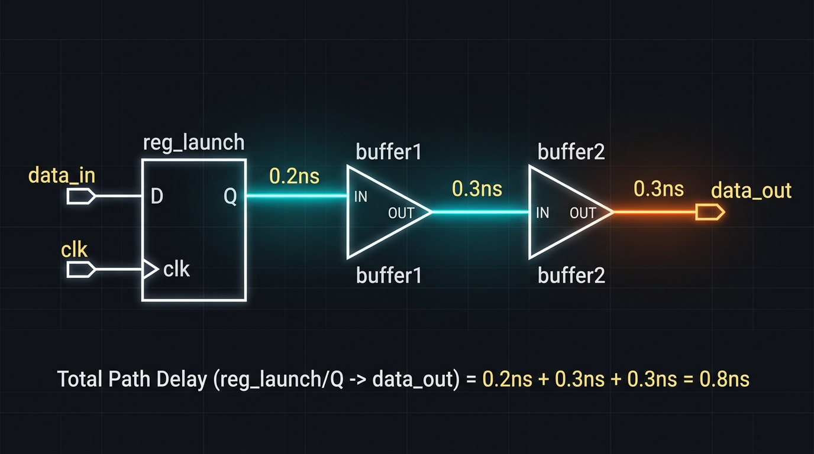
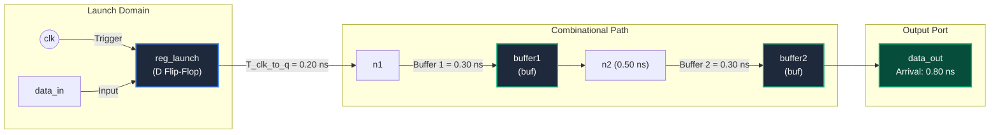

# Static Timing Analysis (STA) Hands-on Mini-Project

[](https://github.com/the-eda-gurus/opensta)
[]()
[]()
[]()

A hands-on mini-project demonstrating **Static Timing Analysis (STA)** for digital integrated circuit (IC) design using the open-source EDA engine **OpenSTA**.

This project illustrates how digital design tools mathematically calculate signal propagation delays, verify setup/hold constraints, detect timing violations, and perform timing closure without running time-consuming SPICE transistor simulations.

---

## 📌 Circuit Schematic & Architecture

The digital circuit path consists of a **Launch Register (`reg_launch`)** driving two sequential **Buffer Gates (`buffer1` & `buffer2`)** to an output port (`data_out`).



### Hardware Path Diagram (Mermaid)



---

## 📁 Repository Files

| File Name | Description |
| :--- | :--- |
| **`circuit.v`** | Verilog structural netlist defining the top module `simple_circuit`, `dff`, and `buf` instantiations. |
| **`sky130_mock.lib`** | Liberty (`.lib`) cell timing library specifying delay parameters, thresholds, and transition times. |
| **`constraints.sdc`** | Synopsys Design Constraints defining the clock period ($1.50\,\text{ns}$) and boundary delays ($0.10\,\text{ns}$). |
| **`run_sta.tcl`** | Automation Tcl script commanding OpenSTA to parse files, link design, and generate setup checks. |
| **`generate_html_report.py`** | Python helper script to parse text reports and generate an interactive HTML dashboard. |
| **`timing_report.html`** | Generated visual web dashboard for viewing timing metrics and delay timelines. |

---

## 🧮 Mathematical Formulas & STA Calculations

Static Timing Analysis measures the safety margin known as **Slack**:

$$\text{Slack} = \text{Data Required Time} - \text{Data Arrival Time}$$

### 1. Data Arrival Time ($T_{\text{arrival}}$)
Sum of all delays along the launch register and combinational path:

$$T_{\text{arrival}} = T_{\text{clk-to-q}} + \sum T_{\text{gate\_delays}}$$

$$T_{\text{arrival}} = 0.20\,\text{ns} + 0.30\,\text{ns} + 0.30\,\text{ns} = \mathbf{0.80\,\text{ns}}$$

### 2. Data Required Time ($T_{\text{required}}$)
The target deadline computed from the clock period and external delay:

$$T_{\text{required}} = T_{\text{period}} - T_{\text{output\_delay}}$$

$$T_{\text{required}} = 1.50\,\text{ns} - 0.10\,\text{ns} = \mathbf{1.40\,\text{ns}}$$

### 3. Slack & Timing Closure
$$\text{Slack} = 1.40\,\text{ns} - 0.80\,\text{ns} = \mathbf{+0.60\,\text{ns}} \quad (\text{MET} \ \checkmark)$$

> **Result**: Because $\text{Slack} > 0$, the signal arrives **$0.60\,\text{ns}$ before the deadline**, guaranteeing reliable chip operation.

---

## 📊 OpenSTA Terminal Output

```text
Startpoint: reg_launch (rising edge-triggered flip-flop clocked by clk)
Endpoint: data_out (output port clocked by clk)
Path Group: clk
Path Type: max

  Delay    Time   Description
---------------------------------------------------------
   0.00    0.00   clock clk (rise edge)
   0.00    0.00   clock network delay (ideal)
   0.00    0.00 ^ reg_launch/clk (dff)
   0.20    0.20 ^ reg_launch/q (dff)
   0.30    0.50 ^ buffer1/x (buf)
   0.30    0.80 ^ buffer2/x (buf)
   0.00    0.80 ^ data_out (out)
           0.80   data arrival time

   1.50    1.50   clock clk (rise edge)
   0.00    1.50   clock network delay (ideal)
   0.00    1.50   clock reconvergence pessimism
  -0.10    1.40   output external delay
           1.40   data required time
---------------------------------------------------------
           1.40   data required time
          -0.80   data arrival time
---------------------------------------------------------
           0.60   slack (MET)
```

---

## 🚀 How to Run the Project

### Prerequisites
* **OpenSTA** installed (available via OpenLane2 / nix-shell environment).
* **Python 3** (for generating the HTML dashboard).

### Execution Steps

1. Clone or navigate to the project directory:
   ```bash
   cd sta
   ```

2. Run OpenSTA using the Tcl script:
   ```bash
   sta run_sta.tcl
   ```

3. Open the visual HTML dashboard in your browser:
   ```bash
   # On Windows / WSL:
   explorer.exe timing_report.html
   ```

---

## 💡 Key Learnings & EDA Gotchas

1. **Liberty Sequential Cell Syntax**: Output pins in sequential elements require `related_pin : "clk";` inside `timing()` groups. Omission causes OpenSTA null pointer segmentation faults.
2. **Library Thresholds**: OpenSTA strictly enforces library-level thresholds (`slew_lower_threshold_pct_rise`, `input_threshold_pct_rise`, etc.) at the root of `library()`.
3. **Scalar Delays**: Standard Synopsys Liberty syntax uses `cell_rise(scalar)` and `cell_fall(scalar)` instead of non-standard keywords.

---

## 📜 License
This project is open-source under the MIT License.
